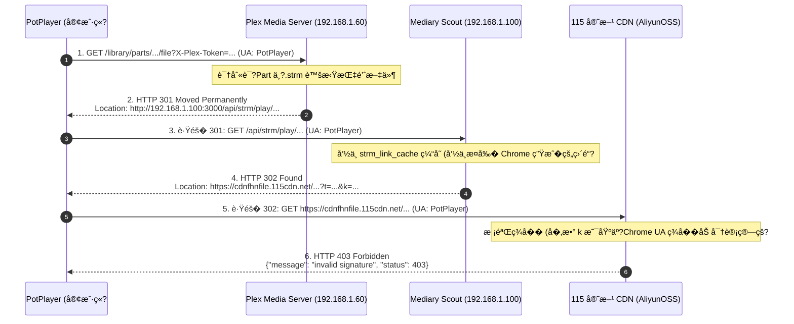

# 深入�障�方案：STRM �Plex 302/301 �定�� PotPlayer 无法播放的根因剖����解决方案

> **文档标识**：`docs/strm-plex-302-potplayer-playback-analysis.md`  
> **涉�组件**：Plex Media Server�STRM 模��15 网盘驱动�StorageStreamResolver�PotPlayer�HTTP �议� 
> **凭�安全规范**：本文档严格�循安全规范，所�IP�Token�Cookie ��感路径�采用 RFC 5737 虚拟��符（�`192.168.1.60`�`TOKEN_REDACTED`）�
---

## 1. �象�盘�全链路时��
### 1.1 触�场景
用户�PotPlayer 中打开 Plex 的媒�Part 地�（或�Plex 客户端选择通过外部播放�PotPlayer 串�）：
```http
http://192.168.1.60:32400/library/parts/176457/1794396015/file?X-Plex-Token=TOKEN_REDACTED
```
该媒体在 Plex 库中�际�Mediary Scout 生��`.strm` 虚拟指针文件挂载，STRM 文件内记录了 Mediary 的播放中�URL�```http
http://192.168.1.100:3000/api/strm/play/strm_task_demo/3559788337009002016?name=demo.mkv&token=demo_token&exp=1825932015
```
**�象**：PotPlayer 无法打开播放该�，�示“无法播放该文件�或�默闪退�
---

### 1.2 全链路抓包时���际�应分�

通过对生产链路执行�跳�针�追踪诊断，全链�HTTP 交互行为如下�


---

## 2. 根因深度剖� (The Root Causes)

�抓包�测�代�深度审计，该问题是由 **三大技术冲�共�作用引�的链�阻断**�
### 核心根因 1�15 CDN 直链强绑�User-Agent 签�，Mediary 缓存缺� UA 维度引�“UA 污染�
- **115 的直链签�防盗链机制**�  115 网盘在调用直链解���（�`proapi.115.com/app/chrome/downurl` 或开放平�API）生�下载直链时，将请求方�带的 `User-Agent` �时间戳深度��了加密哈希�算，并将签�注入 URL �`k` 等鉴��数中�  **115 CDN（阿里云 OSS 节点）在�收下载请求时，会严格比�HTTP 请求头中�`User-Agent` �URL 中的数字签�。一旦两者�完全一致，立�拒�并返�HTTP 403 `{"message": "invalid signature"}`�*
- **Mediary Scout 的缓存设计��*�  �`apps/web/app/api/strm/play/[taskId]/[fileId]/route.ts` 中：
  ```typescript
  const cacheKey = `${storageId}:${fileId}`;
  const cached = await repo.getStrmLinkCache(cacheKey);
  if (cached && !cached.downloadUrl.includes("mock-cdn.cloudpan.com")) {
    return serveStream(request, cached.downloadUrl, ...);
  }
  ```
  `cacheKey` 仅由 `storageId` �`fileId` 组��*完全缺失�User-Agent 维度**�- **����**�  通过直�查询生产数��`strm_link_cache` ��：该直链在数�库中�存的记录为：
  ```json
  {
    "cache_key": "cs_demo:3559788337009002016",
    "delivery_mode": "redirect",
    "headers_json": "{\"User-Agent\":\"Mozilla/5.0 (Windows NT 10.0; Win64; x64) AppleWebKit/537.36 (KHTML, like Gecko) Chrome/150.0.0.0 Safari/537.36\"}"
  }
  ```
  该直链是此�由桌�Chrome �览器访问触�生�的�  �PotPlayer 请求该直链时，Mediary 直�将给 Chrome 生�的直链以 302 丢给 PotPlayer。PotPlayer 带�自己�`PotPlayer` UA �请�115 CDN，触�115 签��匹�，确定性返�**403 Forbidden**�- **对照�验验�**�  - 使用 PotPlayer 或普�curl UA 请求该直链：返� `403 Forbidden` (`{"message": "invalid signature"}`)�  - 使用该直链生�时绑定�Chrome UA 请求该直链：立�返� **`HTTP/1.1 200 OK`，`Content-Length: 1671459959` (1.55GB)**，视频�完好无��
---

### 核心根因 2：HTTP 302 �定��议无法强制客户端�带特定的上游请求头

- �`deliveryMode = "redirect"` 模�下，Mediary �务端返�的是标�`HTTP 302 Found` �`Location: <url>`�- **HTTP 规范约�**�02 �定��能�制下一跳的 URL�*完全无法�制客户端在下一跳请求时使用�Header（如 User-Agent�Referer 等）**�- 客户端在�定�至 115 CDN 时，必然使用客户端自身的网络引� UA（PotPlayer 使用其内置网络库 UA）。�务端�便在数�库或�应头中记录了正确�UA，也无法注入�PotPlayer 的下一跳请求中�
---

### 核心根因 3：媒体�应头阻断（`Content-Disposition: attachment` �`application/octet-stream`�
115 CDN 直链对�视频文件的默�HTTP �应头为�```http
HTTP/1.1 200 OK
Content-Type: application/octet-stream
Content-Disposition: attachment
Accept-Ranges: bytes
```
- `Content-Disposition: attachment`：显�告知客户端这是一个“下载附件�，而��内�播放的�媒体�- `Content-Type: application/octet-stream`：通用二进制�，缺失具体媒�MIME 类�（如 `video/x-matroska` �`video/mp4`）�- �大多数播放器在跟��续 301/302 �定��，��`attachment` 头部时，解�管线无法被正确激活，导致无法识别为音视频媒体��
---

### 次�影�因素 4：Windows SChannel TLS �书链检查����定�
- �Windows �生网络�境（PotPlayer 使用�Windows 系统网络栈）下，直�访问 `https://cdnfhnfile.115cdn.net/` 时，若未�用 CRL/OCSP �销检查，由�部分国内 CDN �OCSP �应延迟或被防�墙拦截，系统�TLS �手会直�抛出：
  `schannel: failed to receive handshake, SSL/TLS connection failed (curl 35)`
- �续两次�定�（`Plex 301 -> Mediary 302 -> 115 HTTPS`）在跨�议（HTTP �HTTPS）�多级跳转过程中，部分旧版播放器�能会丢失 Range 头或导致��断开�
---

## 3. 业界主�开�方案调研�横�对比

针对“网�302 直链 + 第三方播放器（PotPlayer/Infuse/VLC� Plex/Emby�生�中�UA 签�失效�播放阻断问题，业界主�项目的解决策略如下：

| 方案 / 项目 | ��设计�� | 优势 | 局�性�代价 | 对本项目的借鉴价�|
| :--- | :--- | :--- | :--- | :--- |
| **AList / OpenList**<br>`多维缓存�302 直�` | 1. 客户端请求��UA �AList<br>2. AList 用该客户�UA �网盘申请直�br>3. `CacheKey = FileId + MD5(UA) + IP`<br>4. 302 �定�至 CDN | 零�务器带宽消耗；支�大部分�生�传 UA 的客户端 | 若播放器�302 下一跳擅自修�UA（如��览器弹出�PotPlayer），�然会报 403；对��设备无法�用缓存 | **必须借鉴**：STRM 缓存设计必须引入 User-Agent 隔离维度，�止全局串味 |
| **plex2Alist / emby2Alist**<br>`Nginx 智能��代�网关` | �Plex/Emby �挂�Nginx/Lua�br>1. 拦截播放请求<br>2. 识别客户端特�br>3. �到 115/强防盗链时，**自动切��Proxy ��代�**，��Content-Type �Disposition | 播放�功�100%；彻底解决跨域�UA 错��SChannel �手�attachment 弹窗 | 消耗�代�务器的上�下行网络带宽 | **必须借鉴**：在防盗链网盘场景下，系统必须具备��无��退�Proxy 串�中继的能�|
| **M3U / URL 伪�议注�*<br>`#EXTVLCOPT / dpl` | 在生�播放列表时，注入播放器专有指令�br>例如 `#EXTVLCOPT:http-user-agent=...` �PotPlayer �数文件 | 强制播放器带上指�UA �起网络�� | 仅�少数播放器（VLC�Kodi）支�扩展头�*Plex �生完全�支�该机制**；STRM 文件规范�支�自定义�| �适� Plex + STRM �� |
| **Mediary Scout 串�代�**<br>`(In-House Proxy Pipeline)` | �务端作�HTTP 206 Partial Content ��中继�br>1. �务端使用�规固�UA �115 ��直链<br>2. �务端带�规 UA �115 拉�<br>3. ��管��给客户端，�写 inline �video MIME | 彻底脱�客户端差异，零�置�零 403�跨平�播放�100% 顺畅起播 | �用�务端��| **本项目核心方�*：当�系统已��生内置该��代�基础设施，仅需调整路由调度 |

---

## 4. 当�系统已有基础设施���用资产

当� Mediary Scout 代�库中已�拥有完善的基础设施，具备�开�用的解决方案：

1. **高性能�媒体代�中继器 (`handleStreamProxy`)**�   �� `apps/web/app/api/strm/play/[taskId]/[fileId]/route.ts`�   - �生支� HTTP `Range` 头�传�HTTP 206 Partial Content 分片�   - 具备 `buildProxyResponseHeaders`，已内置�     - `inferVideoMimeType(fileName, upstreamContentType)`：将 `application/octet-stream` 智能�写为标�`video/mp4` �`video/x-matroska`�     - `content-disposition: inline; filename="..."`：将网盘�`attachment` 强制矫正�`inline`，��播放器退化为下载模��     - `Accept-Ranges: bytes`：支�进度�任�拖拽 Seek�     - CORS 跨域请求头全�开放�   - 具备 `buildUpstreamHeaders`：自动将直链解�时存储的 `customHeaders`（��规 `User-Agent`）作为上游请求头��给 115�2. **传输交付模�抽象 (`deliveryMode`)**�   - 任务�置�数�库�`strm_task_configs` 已�支� `delivery_mode: "redirect" | "proxy"`�   - `stream-resolver.ts` 支�输出 `deliveryMode`�
---

## 5. 具体解决方案�改造规�
为了兼顾�*性能直�� �务器带宽）**���*�对兼容性（100% 播放�功�*�，�施三层防御改造：

### 5.1 方案 A：修�Cache Key，��User-Agent 交�污染 (P0)

�`apps/web/app/api/strm/play/[taskId]/[fileId]/route.ts` 中，修�缓存生��查询算法：

```typescript
// 规范�User-Agent，��核心标识（�Chrome/VidHub/PotPlayer），��细微版本�导致缓存过度�片化
function normalizeUserAgentKey(ua: string | null): string {
  if (!ua) return "default";
  if (ua.includes("PotPlayer")) return "potplayer";
  if (ua.includes("VidHub")) return "vidhub";
  if (ua.includes("Infuse")) return "infuse";
  if (ua.includes("MicroMessenger")) return "wechat";
  if (ua.includes("Edg/")) return "edge";
  if (ua.includes("Chrome/")) return "chrome";
  return "other";
}

// 缓存键引�UA 维度
const clientUa = request.headers.get("user-agent");
const uaCategory = normalizeUserAgentKey(clientUa);
const cacheKey = `${storageId}:${fileId}:${uaCategory}`;
```
**收益**：彻底消�Chrome �览器� PotPlayer�Infuse 等��设备客户端之间的直链签�污染�
---

### 5.2 方案 B：对 115 / 强鉴�存储驱动�用智能自适应代� (Smart Adaptive Mode) (P0)

针对 115 等��UA 强一致性的网盘，在 `serveStream` 中加入智能客户端侦测�
```typescript
function shouldForceProxyDelivery(request: NextRequest, configDeliveryMode: string): boolean {
  // 1. 若�置显�指�proxy，直�走 proxy
  if (configDeliveryMode === "proxy") return true;

  // 2. 检测已知在 302 下容易丢失或篡改 UA 的播放器 (PotPlayer, MPV, VLC �
  const ua = request.headers.get("user-agent") || "";
  const isProneToUaDrop =
    ua.includes("PotPlayer") ||
    ua.includes("libmpv") ||
    ua.includes("VLC") ||
    ua.includes("Lavf") || // FFmpeg
    !ua; // 缺失 UA

  return isProneToUaDrop;
}
```
**收益**�- 当�览器或支�良好直链签�的客户端访问时，继续享�302 零带宽直�；
- 当检测到 PotPlayer�FFmpeg�Plex 内部�针时，自动切��`handleStreamProxy`，通过�务端管�以 HTTP 206 ��中继输出，��`inline` �`video/x-matroska`，确�PotPlayer 秒开播放�
---

### 5.3 方案 C：STRM 任务�置支�设置 `deliveryMode` �`proxy`

�STRM 任务�置�编辑弹窗（`create-strm-task-modal.tsx` / `edit-strm-task-modal.tsx`）中，确�用户��115 网盘任务�确选择 **“串�代�模�(Proxy)�*。对�家庭�兆内网�境，�务器代�仅�用局域网内网带宽，�彻底消除公网 CDN ��防盗链��干扰�
---

## 6. 自动化测试�防�归门�规�
为���续开������破�该播放链路，必须�地以下测试套件�门��障：

### 6.1 �元测试：Cache Key �User-Agent 隔离性验�- **测试用例**：`packages/workflow/src/strm/strm-cache-key.test.ts`
- **断言目标**�  1. 使用 Chrome UA 请求生�的直链，�能被��PotPlayer UA 的�续请求命中�  2. 相�客户端类别的�续请求必须能够平滑命中有效缓存，�引���直链解�请求�
### 6.2 集�测试：串�代�模�头部规范化断言
- **测试用例**：`apps/web/app/api/strm/play/stream-play.test.ts`
- **断言目标**�  1. 上游返� `Content-Disposition: attachment` 时，`handleStreamProxy` 输出必须被强制更正为 `inline`�  2. 上游返� `application/octet-stream` 时，根�文件扩展�（�`.mkv`）必须正确输�`video/x-matroska`�  3. 支� `Range: bytes=0-1024` 分片请求，必须正确返�HTTP 206 �`Content-Range` �应头�
### 6.3 冒烟验收标准（�机��Checklist�1. �Plex 中打开任�基� 115 网盘�STRM 媒体，�制其 Part 链��PotPlayer 中打开，视频需�1 秒内开始播放�2. 拖动 PotPlayer 进度�至 50% 处，必须能够精准 Seek 且��403 错误�3. �时�Edge �览器�Chrome �览器� PotPlayer 中打开�一 STRM 链�，三者�需正常播放，�得出�任何一方将�一方直链冲刷失效的情况�
